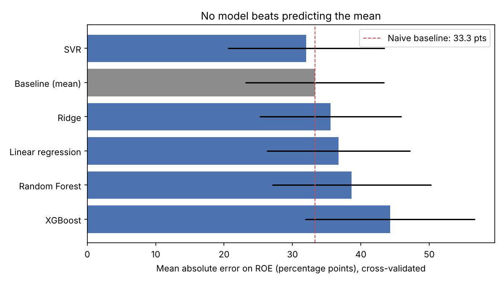
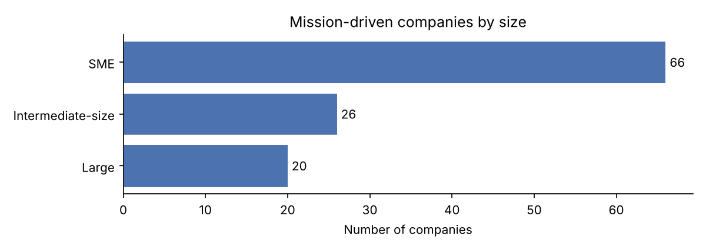
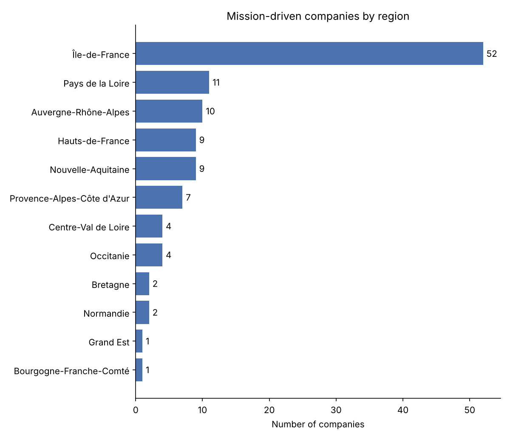

# Financial Performance and Social Responsibility in Mission-Driven Firms

Do CSR commitment and customer sentiment explain the profitability of French *sociétés à mission* (mission-driven companies)?

This project builds its own dataset from scratch (web scraping of four sources, joined on the SIREN company identifier), scores 171,809 customer reviews with NLP, and tests whether a CSR score and the customer sentiment score explain the 2021 return on equity (ROE).

> Revised 2026 version of my Master's thesis (M2 MASERATI, Université Paris-Est Créteil, 2025, supervised by Pr Zineb Abidi).

## Key findings

- **No model predicts ROE better than the mean.** Across six models evaluated with repeated cross-validation, none beats a naive baseline.
- **No significant link** between ROE and the CSR score (OLS p = 0.90) or the customer sentiment score (p = 0.31), in either linear regression or Spearman correlations.
- In this sample, profitability is driven by factors the available variables do not capture. With 58 usable companies and a CSR score that is only a proxy, the study cannot detect a small effect. This should be read as an absence of evidence, not as evidence of no effect.



## Data pipeline

| Step | Source | Result |
|---|---|---|
| 1. Company list | [Observatoire des sociétés à mission](https://www.observatoiredessocietesamission.com/) | 2,003 companies |
| 2. Company details | Observatoire (company pages) | sector, region, creation date, mission adoption date |
| 3. SIREN | [annuaire-entreprises.data.gouv.fr](https://annuaire-entreprises.data.gouv.fr/) | SIREN found for 1,994 companies |
| 4. Customer reviews | Trustpilot | 195,160 reviews for 115 companies |
| 5. Financial data | Pappers | revenue, net income, equity, debt, ROE, 2020–2023 |
| 6. Size and activity | annuaire-entreprises.data.gouv.fr | size category, NAF code |

The analysis dataset (`data/processed/analysis_dataset.xlsx`) contains **112 companies** with both reviews and financial data. It was assembled from these sources by merging on SIREN, averaging the BERT score per company and computing the CSR proxy. Part of this assembly was done by hand in 2025, so the file is provided as is.

Data were collected in 2025. The collection scripts are kept for transparency, but the websites may have changed since then.

## Customer sentiment (NLP)

1. **Cleaning** (`src/nlp/01_clean_reviews.py`): removes URLs, symbols, empty reviews, reviews shorter than 5 characters, and reviews made only of punctuation or emojis. 171,809 of 195,160 reviews are kept (88%), covering 114 companies. Ratings are very unbalanced: 72% of the reviews have 5 stars.
2. **BERT** (`nlptown/bert-base-multilingual-uncased-sentiment`): predicts a rating from 1 to 5 directly from the French text.
3. **VADER**: rule-based English lexicon, applied after translating the reviews to English. The compound score is mapped to a rating from 1 to 5.
4. **Validation**: both predictions are compared with the stars actually given by the customer. The company-level sentiment variable `bert_sentiment_score` is the mean BERT rating of its reviews.

## Modelling

**Target:** ROE 2021 = net income / equity × 100.
**Features:** CSR score, BERT sentiment score, log(revenue), log(financial debt).

Methodological choices (`src/modeling.py`):

- **No target leakage.** Net income and equity make up the ROE itself, so they are not used as features. Operating result is excluded too, because it is almost identical to net income.
- **Meaningful ROE only.** 13 companies with zero or negative equity are excluded: when equity is negative, a loss shows up as a positive ROE. 58 companies remain.
- **Extreme values.** ROE is winsorised at the 5th and 95th percentiles (range: −155.7% to 70.3%).
- **Robust evaluation.** Each model is evaluated with 5-fold cross-validation repeated 20 times and compared with a baseline that always predicts the mean. Missing values are imputed inside the pipeline, so the imputation only learns from the training folds.

| Model | MAE (ROE points) | RMSE | R² |
|---|---|---|---|
| Baseline (mean) | 33.3 | 50.6 | −0.25 |
| SVR | 32.0 | 50.9 | −0.20 |
| Ridge | 35.6 | 52.7 | −0.42 |
| Linear regression | 36.7 | 53.6 | −0.49 |
| Random Forest | 38.7 | 56.2 | −0.70 |
| XGBoost | 44.3 | 62.5 | −1.35 |

*Mean over the 100 cross-validation folds. R² is negative even for the baseline because each test fold is small (11–12 companies). SVR's tiny gain over the baseline is well within the fold-to-fold variability (MAE standard deviation ≈ 11 points).*

**Econometric check:** OLS with HC3 robust standard errors on the 46 companies with complete data. No coefficient is significant (CSR score p = 0.90, sentiment p = 0.31, log revenue p = 0.95, log debt p = 0.34). Spearman correlations with ROE are all below 0.15 in absolute value, and none is significant (`results/spearman.csv`).

## Descriptive overview

- **Size:** 66 SMEs, 26 intermediate-size companies, 20 large companies.
- **Region:** 52 of the 112 companies (46%) are based in Île-de-France.
- **Missing data:** financial data are often missing, from 29% to 56% depending on the indicator and the year (`results/missing_values_by_year.csv`).
- **Correlations:** the sentiment score is slightly negatively correlated with company size (−0.23 with revenue). Larger companies tend to receive lower ratings.

| | |
|---|---|
|  |  |

## Limitations

- **The CSR score is a proxy.** It combines an age class (1–4) and a size class (1–3). It measures maturity and size more than actual CSR practices. A better measure would rely on non-financial reporting, ESG ratings or the content of each company's mission statement.
- **Small sample.** Only 58 companies have a usable ROE, and some large companies dominate the amounts.
- **Single year.** This is a cross-section of 2021, so causality cannot be established.
- **Selection bias.** Only companies present on Trustpilot and with published accounts are included. These are mostly consumer-facing companies.
- **Unbalanced reviews.** Trustpilot ratings are dominated by 5-star reviews, which limits how much the sentiment score varies.

## Repository structure

```
├── data/
│   ├── raw/                  # company list, details, SIREN, size and activity
│   └── processed/
│       ├── analysis_dataset.xlsx            # one row per company (112)
│       └── reviews_summary_by_company.csv   # review counts and mean rating (no text)
├── src/
│   ├── config.py             # all paths
│   ├── collection/           # 01-06: scraping scripts (2025)
│   ├── nlp/                  # 01-05: cleaning, BERT, translation, VADER, validation
│   ├── descriptive.py
│   └── modeling.py
├── results/                  # tables and figures produced by the scripts
└── requirements.txt
```

## Reproduce the analysis

```bash
pip install -r requirements.txt
python src/descriptive.py
python src/modeling.py
```

The two analysis scripts run from the published files. The collection and NLP scripts need Chrome, network access and the raw review file.

## Data and ethics

The raw Trustpilot reviews are **not published**: they contain personal content, and Trustpilot's terms of use do not allow redistribution. Only aggregated counts and mean ratings per company are shared. Company identifiers come from the French public business register (open data).

---

**Author:** Safaa Bourennane · [GitHub](https://github.com/SafaaBr) · bourennanesafaa@gmail.com
